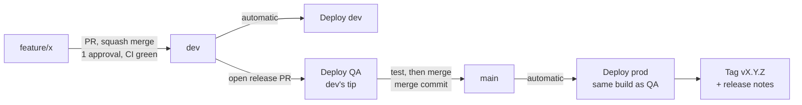

# Branching and releases

Back to [[00 Home]]. The flow from Brian's SRE friend's notes (2026-10-20), the same in [[My pattern]] (GitHub) and [[Yield work pattern]] (Bitbucket).

## The rules
- **`dev`** is long-lived and the default branch. Every change reaches it by a PR, **squash merged**, so one PR = one commit on `dev`.
- Merging into `dev` **deploys dev** with no manual run. Deploy to Dev stays as an optional button for trying a feature branch.
- A **release PR** from `dev` into `main` is the only way into `main`. Merge it with a **merge commit**: the PRs are already squashed, and a merge commit keeps `dev`'s tip as its second parent.
- Opening or updating the release PR **deploys QA** with `dev`'s tip (`qa.yml`; Bitbucket: the `pull-requests: dev` pipeline). New merges into `dev` while it's open redeploy QA, so QA always runs what the merge would ship. Test there before merging. QA was a coworker's suggestion (2026-10-20); Brian chose "QA on the release PR" over a separate `qa` branch, which would add a second release PR to every change.
- Merging the release PR **deploys prod** with the build `dev` and QA already ran, then tags the next version. The gates: the prod role trusts only `main`, the merger must be in `PROD_APPROVERS`, and `release-sha.sh` refuses anything on `main` that isn't a merge from `dev`.
- Open or update the release PR **after** the dev pipeline for `dev`'s tip is green, or QA won't find the build (re-run the QA job if so).
- **Rollback**: run Roll back prod (GitHub) or `rollback-prod` (Bitbucket) on `main` with the `Build:` SHA from an older release.

## Build once
The release merge commit has a new SHA but the same files as `dev`'s tip. Prod deploys `builds/<dev tip>/app.zip`, the exact zip that ran in dev and QA, not a rebuild. `check-prod.sh` accepts a SHA only if it was `main`'s tip or `dev`'s tip at a release merge, so a commit in the middle of `dev` can't go to prod on its own.

## Versioning
PR titles follow **Conventional Commits** (`feat: ...`, `fix(api): ...`, `feat!: ...`). The squash commit takes the PR title, so `scripts/ci/next-version.sh` can read the history since the last `v*` tag:

| Since the last tag | Bump |
|---|---|
| any `type!:` or a `BREAKING CHANGE:` line | major |
| any `feat:` | minor |
| anything else | patch |

The first release is `v0.1.0`. `scripts/ci/release-notes.sh` lists the build SHA and one line per PR. GitHub publishes that as a **GitHub release**; Bitbucket has no Releases page, so it goes in the **annotated tag's message**. The tag goes on only after prod is healthy, so a tag means "was in prod".

## What each platform can enforce

| Rule | GitHub Free (private) | GitHub Pro | Bitbucket Premium (work) |
|---|---|---|---|
| 1 approval before merge | by hand | branch protection | merge check, blocking |
| CI green before merge | by hand (CI still runs) | required status check | merge check, blocking |
| Code owners review | `.github/CODEOWNERS` requests review only | required | `.bitbucket/CODEOWNERS` suggests reviewers only |
| `dev`/`main` not deleted, no direct push | by hand | branch protection | branch restrictions |
| Squash into dev, merge commit into main | by hand (merge methods are repo-wide) | by hand | by hand (chosen at merge time) |
| Only `dev` into `main` | `pr-rules.yml` goes red, can't block; prod refuses | same | prod refuses (`release-sha.sh`) |
| QA green before merging the release PR | by hand (`QA` check shows on the PR) | required status check | merge check "passing builds" on `main`, blocking |
| Conventional PR title | `pr-rules.yml` goes red, can't block | required status check | not checked (no PR title in Pipelines); a bad title counts as a patch |

Sources: GitHub's plans page lists protected branches and code owners for private repos under Pro; Atlassian's merge checks page says merge checks only warn without Premium.

> [!warning] Solo on GitHub
> GitHub doesn't let you approve your own PR. Alone in the repo, a required approval (on Pro) would block every merge unless you bypass it as admin. Here, "1 approval" is practice for work.

> [!note] Not sure
> Whether GitHub's "Automatically delete head branches" would delete `dev` after a release PR merges. Leave it off.

## Setup (by hand)
- GitHub: create `dev` from `main`; Settings > General: default branch `dev`, allow squash and merge commits, "Automatically delete head branches" off.
- Bitbucket: the steps at the top of `bitbucket-pipelines.yml` and in [[Yield work pattern]].

Related: [[Dev deploy sequence]], [[Prod release sequence]], [[Glossary]].
