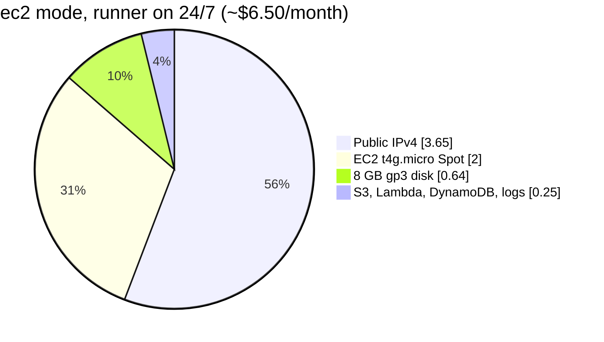
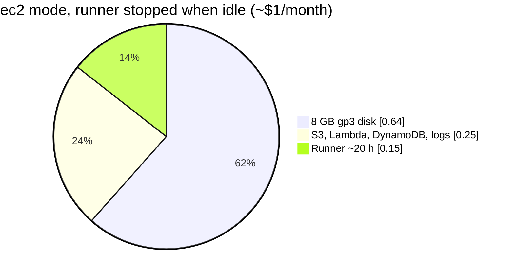

# Cost

Back to [[00 Home]]. Rough us-east-1 numbers. Spot prices move, so treat these as estimates.

| Mode | Monthly |
|---|---|
| `ec2`, runner always on | ~$6.50 |
| `ec2`, runner stopped when idle | ~$1 |
| `github-oidc` or `bitbucket-oidc` | ~$0.25 |

Things deliberately not used: EKS control plane (~$73), NAT gateway (~$33), Transit Gateway attachment (~$36), JFrog cloud (~$150+ per Vendr's estimate), interface endpoints (~$7 each per AZ).

Related: [[Runners]], [[Network]].
