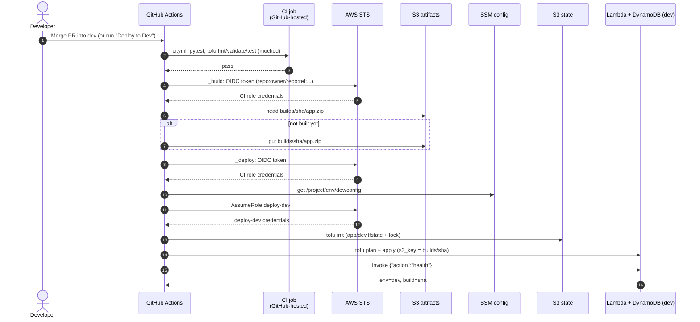

# Dev deploy sequence

Back to [[00 Home]]. A PR merged into `dev` runs this automatically (the Dev pipeline); the optional "Deploy to Dev" button runs the same steps for any branch. A release PR runs the same steps against `qa` (`qa.yml`). Shown in `github-oidc` mode. In `ec2` mode the runner's instance role replaces the OIDC step.

Related: [[Prod release sequence]], [[IAM role chain]].
