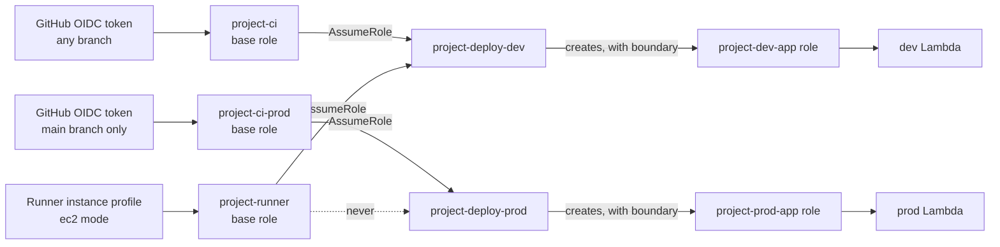
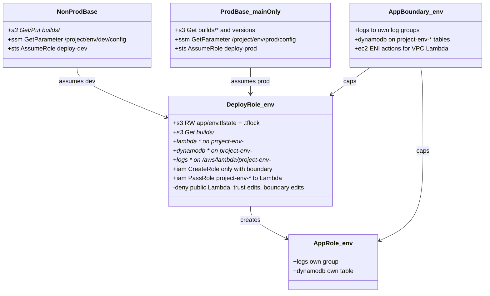

# IAM role chain

Back to [[00 Home]]. Same shape as work's "OIDC base role → provisioner role", see [[Work pattern]].

## What each role can't do
- The runner, and any workflow on a non-main branch, can't get prod credentials at all. AWS checks the OIDC subject claim.
- A dev deploy role can't read or write prod state, resources or roles: every ARN is scoped to `project-dev-*`.
- No pipeline-created role can exceed its boundary, and no deploy role can remove or edit a boundary.
- In the sandbox, every role also carries `yield-boundary` (see [[Sandbox guardrails]]).

Known limit: on GitHub Free anyone with write access can push to `main`. See [[Review findings]].
