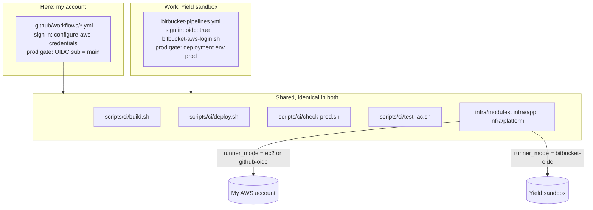

# Local to work: translation guide

How the pattern **here** ([[My pattern]], GitHub + my AWS account) becomes the pattern **at work** ([[Yield work pattern]], Bitbucket + the Yield sandbox), and how both relate to the company's real setup ([[Work pattern]]). Back to [[00 Home]].

## The one rule

Everything that does the work is shared: `infra/` (OpenTofu), `app/`, and `scripts/ci/*.sh`. Each CI system has a thin file that only **signs in** and **decides who may run prod**. A change you test here carries over to work unchanged, unless it touches the CI file itself.

## Word for word

| GitHub Actions (here) | Bitbucket Pipelines (work) |
|---|---|
| `.github/workflows/*.yml` | `bitbucket-pipelines.yml` (one file) |
| Workflow, job | Pipeline, step |
| Reusable workflow `_deploy.yml` (`workflow_call`) | YAML anchor `&deploy-dev` / `&deploy-prod`; at work, a **Dynamic Pipelines** template owned by DevOps |
| `ci.yml` on push | `default:` pipeline |
| `deploy-dev.yml` (`workflow_dispatch`) | `custom: deploy-to-dev` (Run pipeline) |
| `pipeline.yml` (push to `dev`) | `branches: dev` |
| `release.yml` (push to `main`: prod, then tag) | `branches: main` (prod step `trigger: automatic`, then `tag-release`) |
| `rollback.yml` with input `build_sha` | `custom: rollback-prod` with variable `BUILD_SHA` |
| `pr-rules.yml` (only `dev` into `main`, PR title) | merge checks + branch restrictions; prod refuses non-`dev` merges |
| GitHub release (notes = PR list) | annotated tag, message = PR list |
| `.github/CODEOWNERS` | `.bitbucket/CODEOWNERS` |
| `needs:` | Step order (steps run in sequence) |
| `runs-on: ubuntu-latest` | Atlassian-hosted runner (default) |
| `runs-on: [self-hosted, aws]` (my EC2 runner) | `runs-on: [self.hosted, linux, ...]` (work's EKS runners) |
| Repository variables (`vars.X`, `make gh-vars`) | Repository variables (`$X`, `make bb-vars` prints them) |
| `permissions: id-token: write` + `aws-actions/configure-aws-credentials` | `oidc: true` + `source scripts/ci/bitbucket-aws-login.sh <role>` |
| OIDC issuer `token.actions.githubusercontent.com` | `api.bitbucket.org/2.0/workspaces/<ws>/pipelines-config/identity/oidc` |
| OIDC `sub` = `repo:<owner>/<repo>:ref:refs/heads/main` | OIDC `sub` = `{repo-uuid}[:{env-uuid}]:{step-uuid}` |
| Prod gate: IAM trusts only `refs/heads/main` | Prod gate: IAM trusts only the **prod deployment env**; Bitbucket allows only `main` to use it |
| `concurrency: deploy-<env>` | Deployment environments serialise deploys |
| Approval: merging the release PR | merging the release PR (merge checks: 1 approval, passing build) |
| `.github/PROD_APPROVERS` (logins) | `.bitbucket/PROD_APPROVERS` (user UUIDs) |
| `github.sha`, `GITHUB_REF_NAME`, `github.triggering_actor` | `BITBUCKET_COMMIT`, `BITBUCKET_BRANCH`, `BITBUCKET_STEP_TRIGGERER_UUID` |
| `$GITHUB_STEP_SUMMARY` | Step log only |
| `actionlint` | Bitbucket's schema / the online validator |

## Same in both (nothing to translate)

- The IAM chain: base role → `<project>-deploy-<env>`, per-env boundaries, prod base role that the dev path can never reach ([[IAM role chain]]).
- Per-env settings in SSM `/<project>/env/<env>/config` ([[Config outside the repo]]).
- One build per commit at `builds/<sha>/app.zip`, first upload pinned, the same build promoted dev → prod.
- OpenTofu stacks, state layout (`app/<env>.tfstate`), tests, network ([[Network]]).

## Three levels, side by side

| Concern | Here (GitHub, my account) | Yield pattern (Bitbucket, sandbox) | Company golden path (Autobahn) |
|---|---|---|---|
| CI | GitHub Actions | Bitbucket Pipelines, repo-owned YAML | Bitbucket Dynamic Pipelines, DevOps templates via `labels:` |
| Runners | Spot EC2 or GitHub-hosted | Atlassian-hosted (or the EKS runners, if DevOps allows) | Self-hosted EKS in the Tools account |
| AWS sign-in | GitHub OIDC or instance role | Bitbucket OIDC | Harness OIDC connector → `provisioner-*` role |
| Who creates the roles | Me, `infra/platform` | IT applies `infra/platform` (like the StackSet) | CloudFormation StackSet |
| OpenTofu runs in | The CI step (`deploy.sh`) | The CI step (`deploy.sh`) | Harness IACM workspaces |
| Artifacts | S3 `builds/<sha>` | S3 `builds/<sha>` | JFrog + ECR |
| Per-env config | SSM | SSM | Config Graph `infraConfig`, Compass, SSM |
| Prod approval | Release PR merge + `PROD_APPROVERS` | Release PR merge + deployment permissions + `PROD_APPROVERS` | Jira Ops subtask + Production Authorization |

If the Yield team later moves onto the golden path, `deploy.sh` steps 4 and 5 (init/plan/apply, smoke test) become the Harness IACM pipeline, and the shared `build.sh` becomes a JFrog publish. The IAM shape stays the same; only the trusted issuer changes.

## Taking a change from here to work

1. Build and test it here: `make test`, then Deploy to Dev on GitHub.
2. If you changed only `infra/`, `app/` or `scripts/ci/`, it works at work as-is. Copy the commit into the Bitbucket repo.
3. If you changed a workflow file, make the same change in `bitbucket-pipelines.yml` using the table above. Keep logic out of YAML: put it in a `scripts/ci/` script so both sides call it.
4. If you added an AWS permission, it goes in `infra/platform/iam.tf` and IT re-applies the platform in the sandbox.
5. Never copy secrets or account IDs. The sandbox has its own values in its own `terraform.tfvars` and Bitbucket variables.

## Trying the Bitbucket side here first

A free Bitbucket workspace can run this pipeline against my own account: apply `infra/platform` with `runner_mode = "bitbucket-oidc"` and the free workspace's OIDC values. It costs the same as GitHub OIDC mode (~$0.25/month, see [[Cost]]) and uses the free 50 build minutes. The free plan has no deployment permissions, so the prod branch restriction can't be tested there; that is fine for practice, not for a team.
