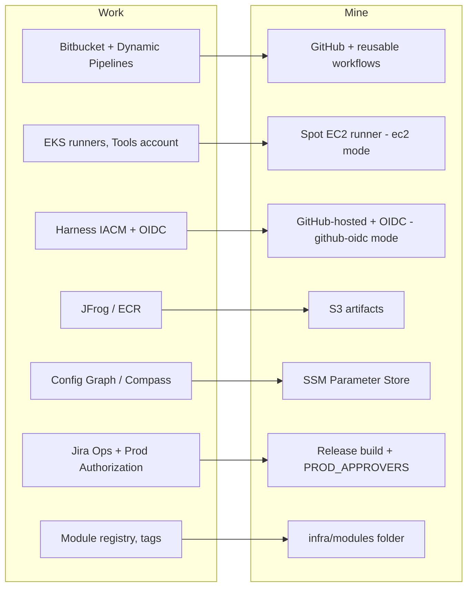

# Mapping: work → mine

Back to [[00 Home]]. Sources: [[Work pattern]] and [[My pattern]]. This compares the company's setup with my GitHub lab. For the Bitbucket version to use at work, see [[Yield work pattern]] and [[Local to work]].

| Work | Mine | Match |
|---|---|---|
| Bitbucket Cloud | GitHub | ✅ equivalent |
| Dynamic Pipelines shared templates, labels in `bitbucket-pipelines.yml` | Reusable workflows (`workflow_call`), thin caller workflows | ✅ same idea; templates still live in the same repo (move out later) |
| Layer 1 module registry, git-tag versioned | `infra/modules/lambda-app` | 🟡 one module, not yet a separate tagged repo |
| Layer 2 IACM pipeline: init → plan → APPROVE → apply | `_deploy.yml`: init → plan → apply; prod approval = Release build + `PROD_APPROVERS` | 🟡 approval is a manual run, not a pause in the same run (that needs GitHub Pro) |
| Layer 3 pattern repos | `infra/app` | 🟡 in the same repo |
| Autobahn scaffolder | Nothing yet (plan: GitHub template repo + a script) | ❌ |
| EKS self-hosted runners, autoscaled, `size` label | One Spot EC2 runner (`ec2` mode) or GitHub-hosted (`github-oidc` mode) | 🟡 no autoscaling, no sizes |
| Runners in a separate Tools account, TGW + Palo Alto egress | Runner in the same account, internet gateway, no inbound | ❌ different on purpose (cost); see [[Runners]] |
| Harness OIDC connector → base role → `provisioner-*` role | GitHub OIDC (or runner role) → base role → `deploy-<env>` role | ✅ same chain; see [[IAM role chain]] |
| Provisioner roles pre-created by StackSet | Created by `infra/platform` (you or IT apply it once) | ✅ equivalent |
| IACM workspaces dev/test/prod | State files `app/dev.tfstate`, `app/prod.tfstate` | ✅ equivalent; add `test` with one variable |
| Envs DEV → TEST → QA → PSUP → PROD | dev → prod | 🟡 fewer envs (cost); list is a variable |
| Branches → dev/test only, `main` → higher envs | Any branch → dev; only `main` SHAs → prod | ✅ |
| Same build number promoted in order, no skipping | Same S3 object (`builds/<sha>`) promoted dev → prod, prod needs dev first | ✅ |
| Jira Ops subtask (`repoSlug`, `branch`, `build`) | Release build workflow input `build_sha` | 🟡 no ticket system |
| `svc-autobahn` service account + Production Authorization | `PROD_APPROVERS` allow-list check | 🟡 workflow-level check; see [[Review findings]] |
| JFrog Artifactory + proxy, ECR | S3 artifact bucket | 🟡 no package proxy; no container images |
| Sonar quality gate | None | ❌ (SonarCloud is free for public repos only) |
| Config Graph `infraConfig`, Compass, SSM | SSM Parameter Store `/<project>/env/<env>/config` | ✅ see [[Config outside the repo]] |
| Validate task-role IAM permissions before deploy | Permissions boundary + `tofu test` checks | 🟡 enforced, not reported |
| Service Catalog product backed by CloudFormation | OpenTofu module applied directly | 🟡 different engine, same "golden product" idea |
| CloudWatch monitoring of runners | Log groups for Lambdas only | ❌ |
| Snowflake network policy / IP allow-list | n/a | – |

## What's missing, in priority order
See [[Gaps and next steps]].
