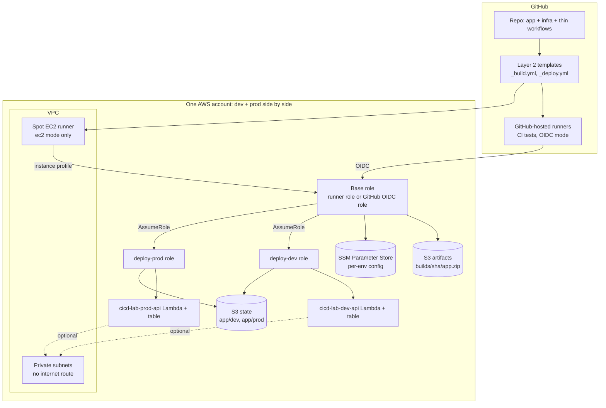

# My pattern

What `aws-cicd-pipeline` builds. Back to [[00 Home]]. Mapped against work in [[Mapping]].

## Three layers, like the golden patterns

| Layer | Here | Later |
|---|---|---|
| 1 Modules | `infra/modules/lambda-app` | its own repo, pinned by git tag (`?ref=v1.2.0`) |
| 2 Pipeline template | `.github/workflows/_build.yml`, `_deploy.yml` (`workflow_call`) | its own repo, pinned `uses: ...@v1` |
| 3 Pattern | `infra/app` + thin caller workflows `deploy-dev.yml`, `pipeline.yml`, `release.yml`, `rollback.yml` | one repo per team service, made from a GitHub template repo |
| Platform | `infra/platform`: VPC, base role, deploy roles, artifact bucket, (runner) | pre-created by IT in the sandbox, like the StackSet |

## Components

## Two modes
See [[Runners]] for the reasoning.
- `runner_mode = "ec2"`: self-hosted Spot runner in the account (pattern A shape).
- `runner_mode = "github-oidc"`: GitHub-hosted runners federate in with OIDC (pattern B shape). No runner, no internet gateway. Required for the [[Sandbox guardrails]].
- `runner_mode = "bitbucket-oidc"`: the same, with Bitbucket Pipelines as the issuer. That is the [[Yield work pattern]]; see [[Local to work]].

## Pipelines
- CI on every push and PR: pytest, `tofu fmt`, `tofu validate`, `tofu test` with a mocked AWS. Free, no AWS access.
- Merge a PR into `dev`: build once, deploy dev. **Deploy to Dev** stays as an optional button for any branch. See [[Dev deploy sequence]].
- Merge the release PR (`dev` into `main`, by someone in `PROD_APPROVERS`): the same build goes to prod, then a `vX.Y.Z` tag and GitHub release. See [[Prod release sequence]] and [[Branching and releases]].
- **Roll back prod** (from `main`): an older released build, dev then prod.

Related: [[IAM role chain]], [[Network]], [[Config outside the repo]], [[Cost]].
