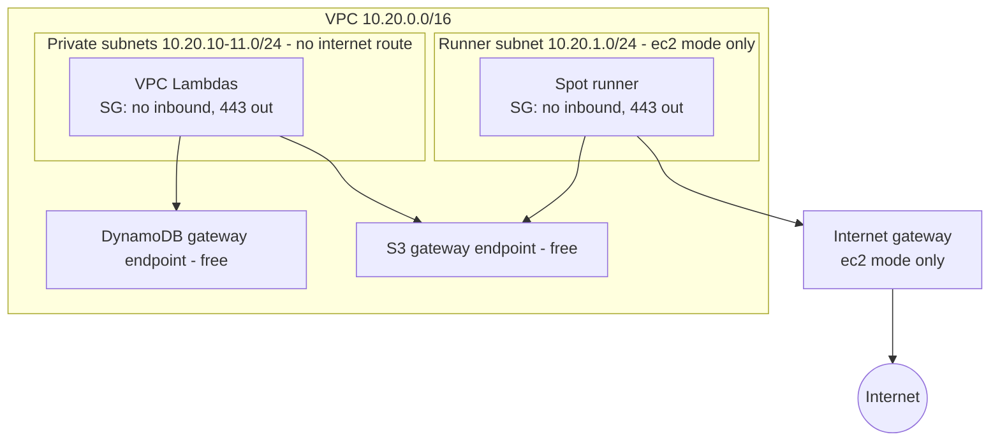

# Network

Back to [[00 Home]].

- No NAT gateway (about $33/month) and no interface endpoints (about $7/month each per AZ).
- In `github-oidc` mode, only the private side exists. That is what the [[Sandbox guardrails]] require.
- At work, egress goes through Transit Gateway and Palo Alto firewalls instead (see [[Runners]]).
