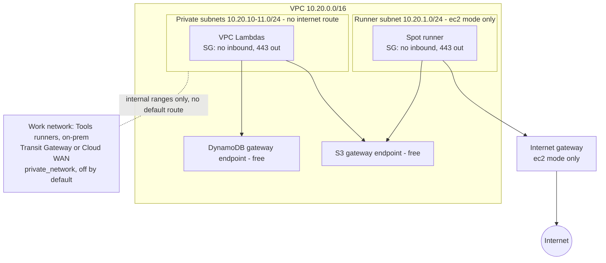

# Network

Back to [[00 Home]].

- No NAT gateway (about $33/month) and no interface endpoints (about $7/month each per AZ).
- In `github-oidc` mode, only the private side exists. That is what the [[Sandbox guardrails]] require.
- At work, egress goes through Transit Gateway and Palo Alto firewalls instead (see [[Runners]]).
- **Private route to work's network (built, off by default, 2026-10-20).** Set `private_network` in `infra/platform` to attach the private subnets to work's Transit Gateway (`transit_gateway_id`) or Cloud WAN (`core_network_arn`) and route `internal_cidrs` there. Validation only accepts private ranges, so a default route can't be added this way. At work, set `vpc_cidr` and `private_subnet_cidrs` to the range Enterprise Networks allocates; the `10.20.0.0/16` default sits inside work's internal space. Pending: the CIDR, and whether the sandbox's route domain has any path to the internet. See [[Runners#Update 2026-10-19: work offers a private route (pending)]].
