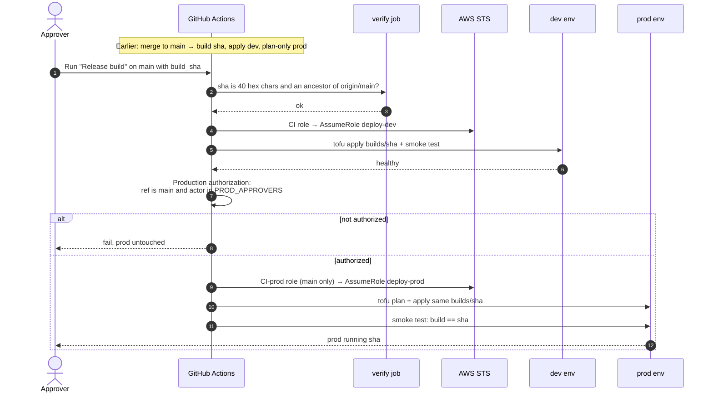

# Prod release sequence

Back to [[00 Home]]. The merge to `main` deploys dev and **previews** prod. Prod only changes through **Release build**, the stand-in for the Jira Ops subtask + Production Authorization.

Rollback is the same run with an older SHA.

Related: [[Dev deploy sequence]], [[Review findings]].
