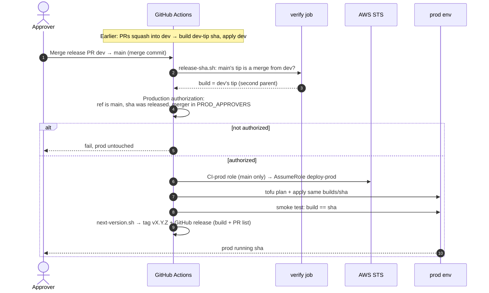

# Prod release sequence

Back to [[00 Home]]. Merging the **release PR** (`dev` into `main`) deploys prod with the build `dev` already ran, then tags the release. This stands in for the Jira Ops subtask + Production Authorization. The branching rules are in [[Branching and releases]].

Rollback: **Roll back prod** on `main` with the `Build:` SHA from an older release. It deploys dev, then prod, and runs the same checks.

Related: [[Dev deploy sequence]], [[Review findings]].
