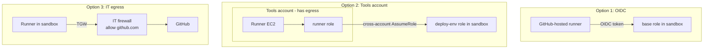

# Runners: why two modes

Back to [[00 Home]].

## What work actually does
Work uses **both** styles (see [[Work pattern]]):
- **Pattern A** (app/DB pipelines): Bitbucket jobs run on **self-hosted runners in EKS**, in a **separate Tools account**. That account has controlled internet egress (Transit Gateway + Palo Alto firewalls), so the runners can talk to Bitbucket and JFrog, and they reach target accounts over the internal network.
- **Pattern B** (Autobahn golden patterns): Harness IACM runs OpenTofu and gets into the target account through an **OIDC connector → base role → provisioner role**. Nothing has to run inside the target account.

## Why I didn't put a runner in the sandbox
A runner must reach GitHub (or Bitbucket) over the internet. The sandbox rule is "no internet gateways, no public IPs, no external internet". So a runner **inside** the sandbox can't work unless IT gives it an egress path. Work solves this by keeping runners in a different account. The sandbox, as you described it, doesn't come with one.

## Options

| | 1. GitHub-hosted + OIDC (built) | 2. Runner in a separate tools account | 3. Runner in sandbox, IT egress |
|---|---|---|---|
| Matches work | Pattern B exactly | Pattern A closely | Pattern A partly |
| Works with no-internet sandbox | Yes | Yes (runner's account has egress, sandbox doesn't) | Only if IT adds a firewall path |
| Who sets it up | You | You (personal: a second free AWS account); IT for the team | IT |
| Extra cost | $0 | ~$1 to $6.50/month (same runner) | Transit Gateway attachment ~$36/month + data, plus IT's firewall |
| Code today | `runner_mode = "github-oidc"` here, `"bitbucket-oidc"` at work ([[Yield work pattern]]) | `ec2` mode + cross-account trust (not built yet) | `ec2` mode minus the IGW (not built) |

## Recommendation
Use **option 1** for the sandbox now: it works on day one, costs nothing, and is the pattern work uses for OpenTofu. If you want to practice the EKS/Tools-account shape, **option 2** is the closest copy, and a second AWS account is free. 

**Default (2026-10-17):** option 1, OIDC with hosted runners, for the sandbox. Chosen as the default while Brian was away; he can overrule it. Reopened 2026-10-19 by the route below, and kept for day one as Q8's assumed default.

## Update 2026-10-19: work offers a private route (pending)
Brian's SRE friend says work will route from its runners (Tools account, the network hub between on-prem and the cloud) to the sandbox VPC. That is option 2 with work's own runners, so Q1 is open again.

A route carries traffic, not AWS credentials. Deploys call AWS APIs, so the route is for reaching private things in the VPC (for example a smoke test against a private service). Day one (one green deploy-to-dev) doesn't need it.

### What work's docs say (2026-10-20, from a work AI assistant, not yet verified)
- **Mechanism:** each VPC gets a Transit Gateway attachment owned by the Enterprise Network Team. VPC route tables send internal private ranges and on-prem traffic to it. Work is moving every VPC from Transit Gateway to **AWS Cloud WAN** through early 2027; IP ranges stay the same and environment separation moves from the Palo Altos to Cloud WAN policies.
- **Route domains:** each attachment sits in a route domain that decides what it can reach. The runner account is in a production inspection domain.
- **Addresses:** each account gets a range from a central allocation managed by Enterprise Networks. The answer gave the runner account's range, not one for the sandbox.
- **Credentials:** runners use Bitbucket OIDC to get an STS role, created by the Service Catalog product that builds the runner cluster, and can deploy cross-account. Older ECS runners had a bug where the instance role silently overrode OIDC; the EKS Auto Mode node role is minimal.
- **Default route:** not documented. Runner internet traffic leaves through a NAT and "through inspection".

### Assumed defaults, pending confirmation (2026-10-20)
Brian asked for the code to go as far as it can without asking anyone yet, so these are Claude's recommended defaults, not Brian's decisions:
- **Q7:** keep Bitbucket OIDC for credentials; the route carries traffic only. Work's own runners already use OIDC, so this also works if Yield moves to them.
- **Q8:** day one stays on Atlassian-hosted runners. The private route is built but off (`private_network = null`), ready for when it's needed.

### Still open, and who to ask
1. **Enterprise Network Team:** will they attach the sandbox VPC, directly to Cloud WAN given the migration? Which route domain or segment, and does it have any path to internet egress? A default route through central egress would break the sandbox's no-internet rule, and the team can edit its own route tables.
2. **Enterprise Network Team:** a CIDR for the sandbox VPC from their allocation. Ours defaults to `10.20.0.0/16`, which sits inside work's internal space. A /24 is plenty for two private subnets.
3. **Runner platform owners (or the SRE friend):** does a job get the target account's role directly from OIDC, or a runner-account role that then assumes into the target? With the second, the prod role can't check the prod deployment environment UUID unless it is passed on, so the prod gate needs rethinking.
4. **Brian's team:** must Yield use work's runners, or are Atlassian-hosted runners allowed? If hosted runners are allowed, the route is optional.

### Guardrails
The SCP now denies Transit Gateway and Cloud WAN attachments and RAM share acceptance to everyone except IT's network role (`OnlyItConnectsToWorkNetwork`, placeholder `<it-network-role>`). Peering, VPN and building your own Transit Gateway stay denied for everyone. See [[Sandbox guardrails]].

Related: [[IAM role chain]], [[Network]], [[Sandbox guardrails]].
