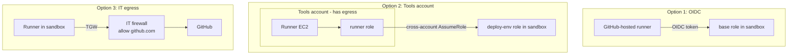

# Runners: why two modes

Back to [[00 Home]].

## What work actually does
Work uses **both** styles (see [[Work pattern]]):
- **Pattern A** (app/DB pipelines): Bitbucket jobs run on **self-hosted runners in EKS**, in a **separate Tools account**. That account has controlled internet egress (Transit Gateway + Palo Alto firewalls), so the runners can talk to Bitbucket and JFrog, and they reach target accounts over the internal network.
- **Pattern B** (Autobahn golden patterns): Harness IACM runs OpenTofu and gets into the target account through an **OIDC connector → base role → provisioner role**. Nothing has to run inside the target account.

## Why I didn't put a runner in the sandbox
A runner must reach GitHub (or Bitbucket) over the internet. The sandbox rule is "no internet gateways, no public IPs, no external internet". So a runner **inside** the sandbox can't work unless IT gives it an egress path. Work solves this by keeping runners in a different account. The sandbox, as you described it, doesn't come with one.

## Options

| | 1. GitHub-hosted + OIDC (built) | 2. Runner in a separate tools account | 3. Runner in sandbox, IT egress |
|---|---|---|---|
| Matches work | Pattern B exactly | Pattern A closely | Pattern A partly |
| Works with no-internet sandbox | Yes | Yes (runner's account has egress, sandbox doesn't) | Only if IT adds a firewall path |
| Who sets it up | You | You (personal: a second free AWS account); IT for the team | IT |
| Extra cost | $0 | ~$1 to $6.50/month (same runner) | Transit Gateway attachment ~$36/month + data, plus IT's firewall |
| Code today | `runner_mode = "github-oidc"` here, `"bitbucket-oidc"` at work ([[Yield work pattern]]) | `ec2` mode + cross-account trust (not built yet) | `ec2` mode minus the IGW (not built) |

## Recommendation
Use **option 1** for the sandbox now: it works on day one, costs nothing, and is the pattern work uses for OpenTofu. If you want to practice the EKS/Tools-account shape, **option 2** is the closest copy, and a second AWS account is free. 

**Decision (2026-10-17):** option 1, OIDC with hosted runners, for the sandbox. Chosen as the default while Brian was away; he can overrule it. Option 2 stays a later exercise.

Related: [[IAM role chain]], [[Network]], [[Sandbox guardrails]].
