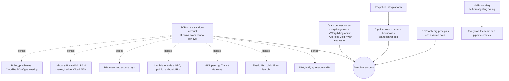

# Sandbox guardrails

Back to [[00 Home]]. Full drafts and the IT checklist are in `sandbox-guardrails/` at the repo root.

Honest limits are in `sandbox-guardrails/README.md`. The main one: dev and prod share the account, so people (not pipelines) with team access can still change prod by hand. Brian accepted that on 2026-10-17 because sandbox prod is a rehearsal ([[Glossary]]).

**Who applies what (Brian, 2026-10-17):** IT applies `infra/platform`, not the team. That is what keeps the pipeline roles out of the team's reach.

The team can still build VPCs, subnets, security groups and VPC endpoints, and create IAM roles named `yield-*`.

Related: [[Network]], [[IAM role chain]], [[Review findings]].
