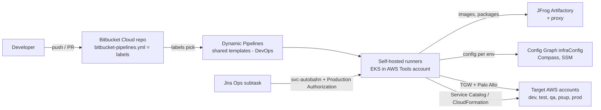
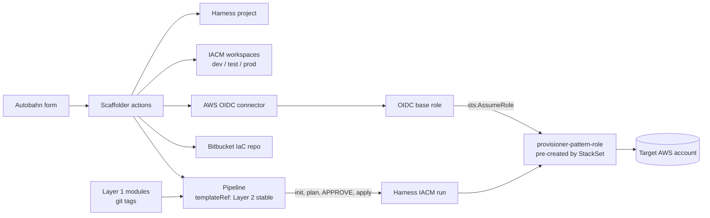

# Work pattern

There are **two** pipelines at work. They share governance but run differently. Back to [[00 Home]].

## A. App and DB pipelines (Bitbucket Dynamic Pipelines)

- A repo is onboarded through **Autobahn**. Its `bitbucket-pipelines.yml` only holds a few `labels:` lines; DevOps owns the shared templates (`db-objects` for Snowflake/Flyway, `ecs-springboot`, `python-serverless`, `angular-ui`, ...).
- Steps run on **self-hosted Bitbucket runners in Amazon EKS** (`runs-on: [self.hosted, eks, autoscaler.created, linux]`; a `size` label picks 1x/2x/4x/8x). The runners live in a **central AWS Tools account** and reach other accounts and systems over **Transit Gateway + Palo Alto firewalls**, with DNS through **Route 53 Resolver**. Images come through the **JFrog proxy**.
- Branches can deploy to `dev` and `test`; only `main` can deploy to `qa`, `psup`, `prod`.
- Prod is triggered by a **Jira Ops subtask** naming `repoSlug`, `branch`, `build`. The same build number moves DEV → TEST → QA → PROD in order. The run starts as `svc-autobahn`, and a required **Production Authorization** check blocks anyone not on the approved list, even repo admins.
- Per-env settings live outside the repo: **Compass** (Snowflake), **Config Graph `infraConfig`** (AWS: VPC, subnets, cluster, secrets), and **SSM Parameter Store**.
- AWS deploys (ECS guide): build, test, **Sonar** scan, Docker image pushed to **JFrog + ECR**, validate the task-role IAM permissions, then create/update an **AWS Service Catalog product backed by CloudFormation**. For prod the image is re-tagged and released through the release workflow.

## B. Autobahn golden patterns (infra with OpenTofu)

Three layers, each its own repo, Bitbucket is the source of truth (CI lint / validate / tag), and **Harness IACM** runs OpenTofu.

| Layer | Repo | What it publishes |
|---|---|---|
| 1 | `template-harness-registry` | Reusable OpenTofu modules (`aws-vpc`, `aws-s3`, `aws-iam-roles`, `aws-cloudwatch`), git-tag versioned (preview, then stable) |
| 2 | `template-harness-pipeline` | Pipeline template: IACM OpenTofu init → plan → approve → apply, versioned `templateRef` |
| 3 | Pattern templates | Consume Layer 1 + Layer 2: `bedrock-agentcore`, `citrix` (planned), `ec2-ami` (planned) |

The **Autobahn scaffolder** turns a form into: a Harness project, IACM workspaces (dev/test/prod), a pipeline linked to Layer 2, a Bitbucket IaC repo, and an **AWS OIDC connector** that assumes a **pre-created** `provisioner-<pattern>-role`. The roles are created ahead of time (a CloudFormation StackSet across OU accounts).

> [!question] Inferred
> Whether Harness IACM executes on Harness-hosted infrastructure or on a delegate inside AWS isn't in the screenshots. The OIDC connector suggests it runs **outside** the target account and federates in, which is what [[Runners|GitHub OIDC mode]] copies.

Related: [[Mapping]], [[Runners]].
