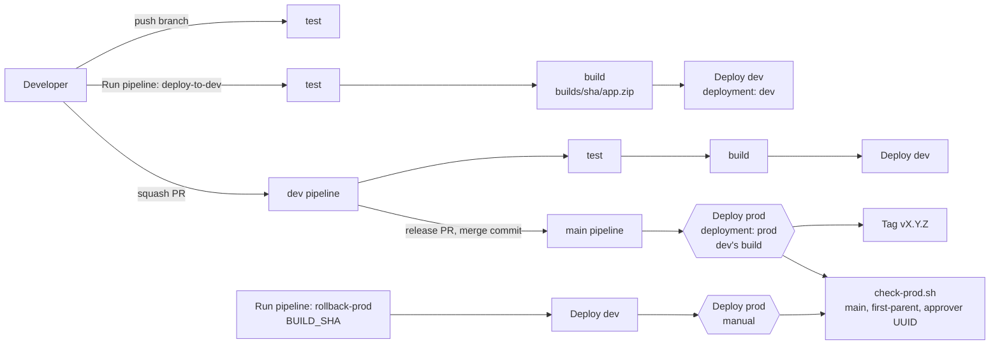
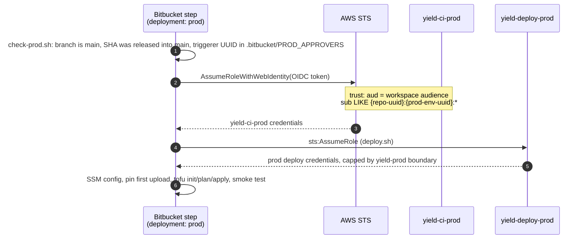

# Yield work pattern (Bitbucket)

The pattern to use **at work**, in the Yield sandbox account: Bitbucket Pipelines, no GitHub anywhere. It is the same pipeline as [[My pattern]] with a Bitbucket front end. How the two line up, piece by piece, is in [[Local to work]]. Back to [[00 Home]].

## What runs

| Trigger | Steps | File |
|---|---|---|
| Push to a feature branch | test | `bitbucket-pipelines.yml` → `default` |
| Merge a PR into `dev` (squash) | test → build → dev | `branches: dev` |
| Merge the release PR `dev` → `main` (merge commit) | prod (dev's build) → tag `vX.Y.Z` | `branches: main` (stands in for the Jira Ops subtask) |
| **Run pipeline → deploy-to-dev** (any branch, optional) | test → build → dev | `custom: deploy-to-dev` |
| **Run pipeline → rollback-prod** on `main`, with `BUILD_SHA` | dev → **manual** prod | `custom: rollback-prod` |

Branch rules and versioning: [[Branching and releases]].

Every AWS step has `oidc: true` and runs the shared scripts in `scripts/ci/`, the same ones GitHub runs. `infra/` is unchanged.

## How prod is protected

- **AWS side.** `yield-ci-prod` trusts only OIDC tokens whose `sub` carries the **prod deployment environment UUID** of this repo. Steps without `deployment: prod` can't get it. Nothing else (the non-prod role, a dev step) can assume `yield-deploy-prod`.
- **Bitbucket side.** AWS can only match `aud` and `sub` for this issuer, and Bitbucket's `sub` has no branch in it. So *which branch may use the prod environment* must be set in Bitbucket: Repository settings → Deployments → prod → **only `main`, only admins**. Those deployment permissions are a **Bitbucket Premium** feature.
- **Script side.** `release-sha.sh` refuses a `main` that isn't a merge from `dev`; `check-prod.sh` refuses non-`main` runs, SHAs no release brought into `main`, and anyone not in `.bitbucket/PROD_APPROVERS`. A branch can edit that script, so it is a speed bump; the two gates above are the real ones.

> [!warning] Turn it on per repo
> The pattern assumes the work workspace has Premium (Brian expects it does, as best practice). Premium only provides the feature: each repo's `prod` environment still needs "only `main`, only admins" set in its Deployments settings (setup step 2). Until it is set, anyone who can push a branch can add `deployment: prod` to the YAML and get prod credentials.

## Setting it up in the sandbox

1. **IT (or you, if allowed) applies `infra/platform`** with `work.tfvars.example` copied to `terraform.tfvars`. The values come from Bitbucket → Repository settings → Pipelines → **OpenID Connect**: identity provider URL, audience, repository UUID, and the dev / prod deployment environment UUIDs.
2. **Bitbucket → Deployments:** environments `dev` (Test) and `prod` (Production). On `prod`, restrict to `main` and admins.
3. **Bitbucket → Repository variables:** paste what `make bb-vars` prints (`AWS_REGION`, `PROJECT`, `TF_STATE_BUCKET`, `ARTIFACT_BUCKET`, `AWS_CI_ROLE_ARN`, `AWS_CI_PROD_ROLE_ARN`). None are secrets.
4. **`.bitbucket/PROD_APPROVERS`:** the Bitbucket user UUIDs allowed to release.
5. Create `dev`, make it the Main branch, and set the branch restrictions and merge checks listed in `bitbucket-pipelines.yml`. Merge a PR into `dev` (deploys dev), then merge a release PR into `main` (deploys prod and tags `v0.1.0`).

The sandbox [[Sandbox guardrails]] already allow the Bitbucket OIDC issuer (`api.bitbucket.org/*`) and block internet gateways, so this mode creates none. Bitbucket's own runners are outside the account and reach AWS APIs over the internet, like GitHub's do in [[Runners|GitHub OIDC mode]].

## Differences from the GitHub version

- Prod deploys as soon as the release PR merges; the merge checks on `main` are the approval. No prod *preview* plan: a Bitbucket deployment environment can be used once per pipeline, so the manual prod step plans and applies in one go. The plan is printed in its log before apply.
- No step summary page; plans and smoke-test results are in the step logs.
- Prod identity is a user **UUID**, not a login name.
- Bitbucket serialises deploys to one environment by itself; GitHub needs a `concurrency:` group.
